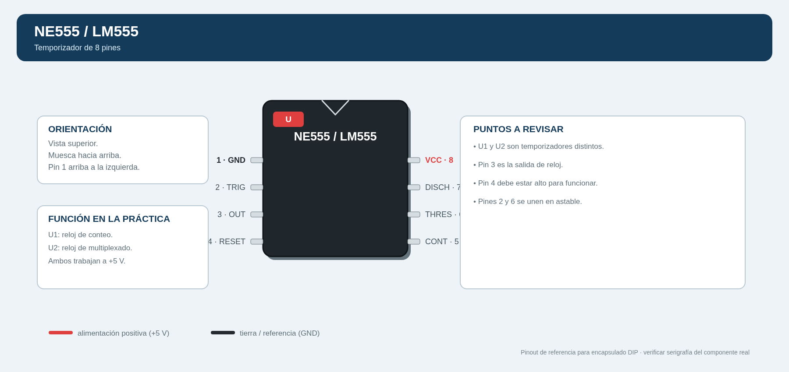
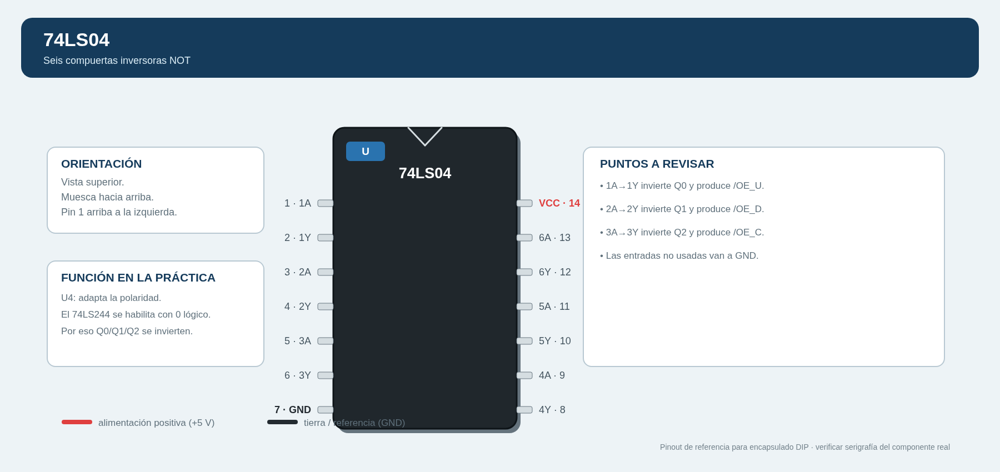
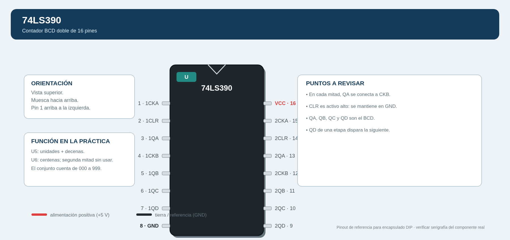
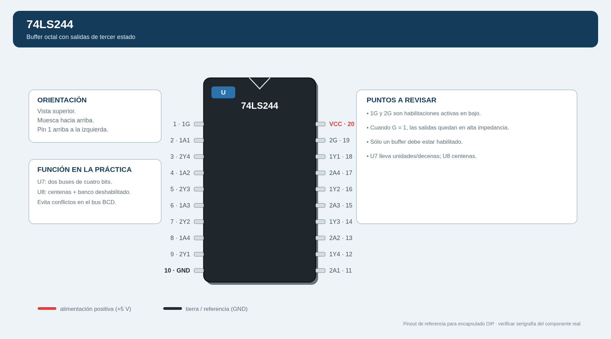
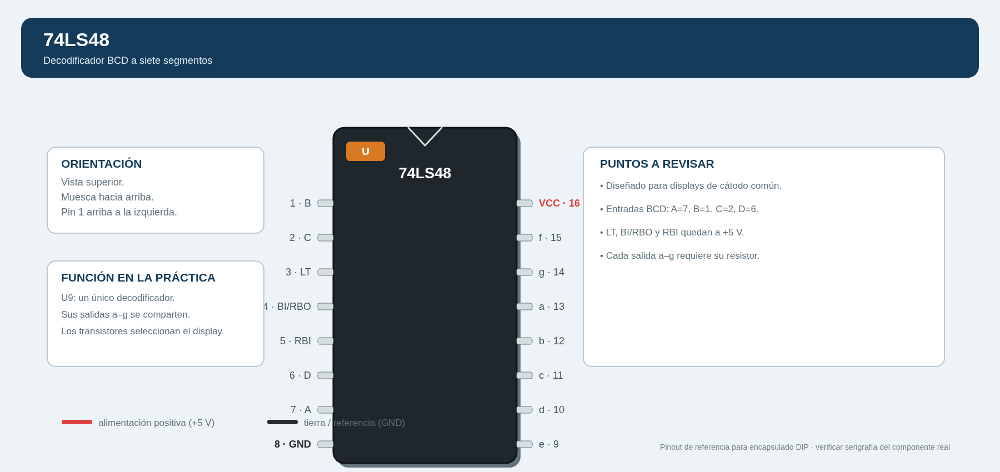

# Guía detallada de montaje físico, pin a pin
## Práctica: desplegado multiplexado de 3 dígitos

Esta guía desarrolla el montaje de los planos A, B y C. El resultado esperado es un contador decimal de tres dígitos, de **000 a 999**, formado por tres displays de siete segmentos de **cátodo común**. Aunque hay tres displays, se emplea un solo decodificador 74LS48: la información BCD de unidades, decenas o centenas se selecciona mediante buffers de tercer estado y cada display se enciende por turnos a suficiente velocidad para que parezcan encendidos simultáneamente.

> **Montaje adoptado:** C.I. en encapsulado PDIP, fuente regulada de +5 V, display de cátodo común genérico de 10 patas y transistores BC337. La muesca o punto del C.I. debe quedar hacia arriba; el pin 1 se ubica arriba a la izquierda y la numeración avanza en sentido antihorario.

---

# 1. Resultado que debe cumplir la práctica

Al finalizar, el sistema debe cumplir lo siguiente:

1. **U1, LM555 de conteo**, genera pulsos lentos. Cada pulso incrementa una unidad.
2. **U5 y U6, 74LS390**, producen tres números BCD: unidades, decenas y centenas.
3. **U2, LM555 de multiplexado**, genera pulsos rápidos, mayores de **150 Hz**.
4. **U3, CD4017**, recorre tres estados: `Q0 → Q1 → Q2 → Q0`.
5. **U4, 74LS04**, invierte Q0, Q1 y Q2 porque las entradas de habilitación de los 74LS244 son activas en bajo.
6. **U7 y U8, 74LS244**, permiten que únicamente un número BCD use el bus de cuatro cables `A, B, C, D` en cada instante.
7. **U9, 74LS48**, traduce el BCD seleccionado a los segmentos `a–g`.
8. **Q1, Q2 y Q3, BC337**, conectan a tierra el cátodo común de sólo un display por vez.
9. Los tres displays muestran, por ejemplo, `027`, `128`, `999`, etc., sin parpadeo perceptible.

La frecuencia mínima de U2 es 150 Hz porque cada display sólo se habilita una de cada tres veces. Así, cada display recibe al menos 50 refrescos por segundo.

---

# 2. Preparación y seguridad

## 2.1 Material adicional necesario

La lista base de la práctica tiene resistores para segmentos y bases, pero un LM555 configurado en modo astable requiere una resistencia fija adicional en el pin de descarga. Para un montaje seguro agrega:

- `R8 = 1 kΩ` para U1.
- `R9 = 1 kΩ` para U2.
- Si se instalan los LED de prueba: `R10` y `R11` de 330 Ω a 1 kΩ, uno por LED.

Los siete resistores de `100 Ω` se reservan para los siete segmentos, y los tres resistores de `1 kΩ` de la lista original se reservan para las bases de Q1, Q2 y Q3.

## 2.2 Identificación del display y transistor

La guía usa este pinout típico de display de cátodo común de 10 patas:

| Pin del display | Función |
|---:|---|
| 1 | Segmento E |
| 2 | Segmento D |
| 3 | Cátodo común, CC |
| 4 | Segmento C |
| 5 | Punto decimal, DP |
| 6 | Segmento B |
| 7 | Segmento A |
| 8 | Cátodo común, CC |
| 9 | Segmento F |
| 10 | Segmento G |

Para un BC337 visto por la cara plana, lo normal es `C–B–E` de izquierda a derecha. **Verifica el transistor real**: un 2N2222 o PN2222A puede tener otro orden.

## 2.3 Imágenes de referencia y patillaje de los C.I.

Las siguientes imágenes muestran la **vista superior** de los encapsulados DIP usados. La muesca queda arriba y el pin 1 siempre queda arriba a la izquierda. Los rieles de +5 V y GND están resaltados para evitar invertir la alimentación.

### U1 y U2 — NE555 / LM555



### U3 — CD4017B


### U4 — 74LS04, compuertas NOT



### U5 y U6 — 74LS390, contadores BCD



### U7 y U8 — 74LS244, buffers de tercer estado



### U9 — 74LS48, decodificador BCD a siete segmentos



> Las imágenes son guías de pinout para DIP. Antes de insertar un C.I. real, compara la muesca, el número impreso y el pin 1 con la serigrafía del encapsulado adquirido.

## 2.4 Preparación de las protoboards

1. Usa dos protoboards, identificadas como **placa A** y **placa B**.
2. En cada placa une los rieles rojos entre sí y los rieles negros entre sí, si están partidos.
3. No coloques aún los C.I. Con un multímetro, verifica que no exista continuidad directa entre el riel rojo y el riel negro.
4. Ajusta la fuente a **5.0 V** antes de conectarla.
5. En la placa A conecta la fuente: positivo al riel rojo y negativo al riel negro.
6. Usa los nueve cables del conector J1, explicados en la sección 6, para llevar alimentación y señales a la placa B.

---

# 3. Placa A: generadores de reloj, selector y lógica de habilitación

## Paso A1. Capacitor de filtrado de la placa A

| Conexión | Qué hace | Por qué se conecta |
|---|---|---|
| C7 de 10 µF: terminal `+` a +5 V; terminal `–` a GND | Filtra variaciones de alimentación | Los cambios de los C.I. y displays pueden introducir ruido; el capacitor estabiliza el riel. |

> Los capacitores electrolíticos tienen polaridad. Si se invierten, pueden dañarse.

## Paso A2. Montar U1, NE555 de conteo

Coloca U1 atravesando la ranura central del protoboard, con la muesca hacia arriba.

| Pin o componente | Conectar a | Qué hace y por qué |
|---|---|---|
| U1-8, VCC | +5 V | Alimenta el temporizador. |
| U1-1, GND | GND | Referencia de 0 V. |
| U1-4, RESET | +5 V | RESET es activo en bajo; al conectarlo a +5 V se permite que U1 oscile. |
| U1-2, TRIG | Unir a U1-6 | Permite que el capacitor de temporización controle el inicio del siguiente pulso. |
| U1-6, THRES | Unir a U1-2 | Detecta cuando el capacitor alcanza aproximadamente 2/3 de VCC. Juntos forman el nodo de temporización 1. |
| C1, 1 µF | Positivo al nodo U1-2/U1-6; negativo a GND | Se carga y descarga para determinar el periodo de conteo. |
| R8, 1 kΩ | Entre +5 V y U1-7, DISCH | Limita la corriente del pin de descarga y protege el potenciómetro. |
| P1, 1 MΩ | Un extremo a U1-7; cursor y tercer terminal unidos al nodo U1-2/U1-6 | P1 actúa como resistencia variable. Cambiarlo modifica la rapidez con que cambia el número mostrado. |
| U1-5, CONT | A C3 de 1 µF; el otro extremo de C3 a GND | Filtra ruido en el voltaje de control y evita disparos falsos. |
| U1-3, OUT | A J1-A pin 3, `CLK_CONTEO` | Es la señal de salida que hace avanzar las unidades. |

### Comprobación de U1

1. Si instalas LED D1, conecta: `U1-3 → R10 → ánodo de D1`; cátodo de D1 a GND.
2. Conecta la fuente. D1 debe parpadear lentamente.
3. Gira P1. El parpadeo debe cambiar de velocidad.
4. Si D1 no parpadea, apaga la fuente y revisa primero U1-1, U1-8, U1-4, la polaridad de C1 y la unión entre U1-2/U1-6.

## Paso A3. Montar U2, NE555 de multiplexado

U2 se conecta igual que U1, pero con valores que producen mayor velocidad.

| Pin o componente | Conectar a | Qué hace y por qué |
|---|---|---|
| U2-8, VCC | +5 V | Alimentación del segundo reloj. |
| U2-1, GND | GND | Referencia de la placa. |
| U2-4, RESET | +5 V | Mantiene habilitada la oscilación. |
| U2-2 y U2-6 | Unidos entre sí | Forman el nodo de temporización 2. |
| C2, 0.1 µF | Entre nodo U2-2/U2-6 y GND | Al ser menor que C1, permite una frecuencia mayor. |
| R9, 1 kΩ | Entre +5 V y U2-7, DISCH | Protege el pin de descarga y el potenciómetro. |
| P2, 100 kΩ | Un extremo a U2-7; cursor y tercer terminal unidos al nodo U2-2/U2-6 | Ajusta la frecuencia de multiplexado. |
| U2-5, CONT | A C4 de 0.1 µF; otro extremo de C4 a GND | Reduce el ruido sobre el nivel de comparación interno. |
| U2-3, OUT | A U3-14, CLK | Cada pulso rápido hace avanzar una salida del CD4017. |

### Comprobación de U2

1. Si instalas D2, conecta `U2-3 → R11 → ánodo de D2`; cátodo de D2 a GND.
2. Ajusta P2 hasta que D2 parezca encendido fijo o muy brillante: eso indica una frecuencia alta.
3. Si se cuenta con osciloscopio o frecuencímetro, ajusta por arriba de **150 Hz**.

## Paso A4. Montar U3, CD4017 como contador de anillo MOD-3

| Pin de U3 | Conectar a | Qué hace y por qué |
|---:|---|---|
| 16, VDD | +5 V | Alimentación del CD4017. |
| 8, VSS | GND | Tierra del CD4017. |
| 14, CLK | U2-3 | Recibe el reloj rápido de multiplexado. |
| 13, CLOCK INHIBIT | GND | En bajo permite contar; si estuviera en alto detendría la secuencia. |
| 3, Q0 | U4-1 y J1-A pin 4 | Selecciona el dato y display de unidades. |
| 2, Q1 | U4-3 y J1-A pin 5 | Selecciona el dato y display de decenas. |
| 4, Q2 | U4-5 y J1-A pin 6 | Selecciona el dato y display de centenas. |
| 7, Q3 | U3-15, RESET | Cuando aparece Q3, reinicia inmediatamente el contador y vuelve a Q0. Por eso el CD4017 queda en módulo 3. |
| 15, RESET | U3-7 | Recibe el pulso de reinicio procedente de Q3. |
| 1, 5, 6, 9, 10, 11, 12 | Sin conexión | Son Q5, Q6, Q7, Q8, Q4, Q9 y Carry Out; no se requieren para tres displays. |

### Resultado esperado de U3

Con una sonda lógica o tres LED de prueba adecuados, las salidas deben repetirse así:

```text
Estado 1: Q0 = 1, Q1 = 0, Q2 = 0  → unidades
Estado 2: Q0 = 0, Q1 = 1, Q2 = 0  → decenas
Estado 3: Q0 = 0, Q1 = 0, Q2 = 1  → centenas
Siguiente pulso: Q3 activa RESET     → regresa a unidades
```

## Paso A5. Montar U4, 74LS04

El 74LS244 se habilita con una señal baja, por lo que hay que invertir las salidas positivas Q0, Q1 y Q2 del 4017.

| Pin de U4 | Conectar a | Qué hace y por qué |
|---:|---|---|
| 14, VCC | +5 V | Alimentación TTL. |
| 7, GND | GND | Tierra TTL. |
| 1, entrada 1A | U3-3, Q0 | Recibe la selección positiva de unidades. |
| 2, salida 1Y | J1-A pin 7, `/OE_U` | Cuando Q0 es alto, la salida se vuelve baja y habilita el banco de unidades de U7. |
| 3, entrada 2A | U3-2, Q1 | Recibe la selección positiva de decenas. |
| 4, salida 2Y | J1-A pin 8, `/OE_D` | Habilita en bajo el banco de decenas de U7. |
| 5, entrada 3A | U3-4, Q2 | Recibe la selección positiva de centenas. |
| 6, salida 3Y | J1-A pin 9, `/OE_C` | Habilita en bajo el banco de centenas de U8. |
| 9, 11 y 13 | GND | Son entradas de tres inversores no usados. Nunca deben quedar flotantes. |
| 8, 10 y 12 | Abiertos | Son salidas de los inversores no usados. No deben unirse entre sí ni a +5 V/GND. |

---

# 4. Conexión entre placas: J1-A a J1-B

Usa nueve cables individuales; conserva el color y el número para evitar confusiones.

| Cable | J1-A | J1-B | Función |
|---:|---|---|---|
| 1 | +5 V | +5 V | Lleva la alimentación a la placa B. |
| 2 | GND | GND | Hace común la referencia eléctrica de ambas placas. |
| 3 | CLK_CONTEO | CLK_CONTEO | Lleva los pulsos lentos de U1 a las unidades. |
| 4 | S0 = Q0 | S0 / Q0 | Activa el transistor del display de unidades. |
| 5 | S1 = Q1 | S1 / Q1 | Activa el transistor del display de decenas. |
| 6 | S2 = Q2 | S2 / Q2 | Activa el transistor del display de centenas. |
| 7 | /OE_U | /OE_U | Habilita en bajo el buffer de unidades. |
| 8 | /OE_D | /OE_D | Habilita en bajo el buffer de decenas. |
| 9 | /OE_C | /OE_C | Habilita en bajo el buffer de centenas. |

> **Por qué se requieren tanto S0/S1/S2 como /OE_U,/OE_D,/OE_C:** las primeras seleccionan los transistores con nivel alto; las segundas habilitan los 74LS244 con nivel bajo. Son la misma selección, pero una está invertida para cumplir la polaridad de cada dispositivo.

---

# 5. Placa B: contadores BCD, buffers, decodificador y displays

## Paso B1. Capacitores y alimentación de la placa B

| Componente | Conexión | Función |
|---|---|---|
| C8, 10 µF | Positivo a +5 V, negativo a GND | Reserva de energía local de la placa B. |
| C5, 0.1 µF | Entre +5 V y GND, cerca de U7/U8 | Desacopla pulsos rápidos de conmutación. |
| U5 y U6 | Pin 16 a +5 V; pin 8 a GND | Alimenta los dos 74LS390. |
| U7 y U8 | Pin 20 a +5 V; pin 10 a GND | Alimenta los buffers. |
| U9 | Pin 16 a +5 V; pin 8 a GND | Alimenta el decodificador. |

## Paso B2. Montar U5, 74LS390 para unidades y decenas

Un 74LS390 contiene dos contadores. Se usa su primera mitad para unidades y la segunda mitad para decenas.

### Unidades

| Pin de U5 | Conectar a | Explicación |
|---:|---|---|
| 1, 1CKA | J1-B pin 3, CLK_CONTEO | Recibe el pulso lento generado por U1. |
| 2, 1CLR | GND | CLR es activo en alto; a GND permite contar normalmente. |
| 3, 1QA | U5-4, 1CKB | Convierte la parte divide entre 2 y la parte divide entre 5 en un contador decimal BCD. |
| 4, 1CKB | U5-3 | Debe recibir QA para completar el ciclo 0–9. |
| 3, 5, 6 y 7 | A, B, C y D de unidades | Forman el número BCD de unidades. |

### Decenas

| Pin de U5 | Conectar a | Explicación |
|---:|---|---|
| 15, 2CKA | U5-7, 1QD | Cuando unidades termina 9 y vuelve a 0, el flanco de QD incrementa las decenas. |
| 14, 2CLR | GND | Mantiene habilitado el contador de decenas. |
| 13, 2QA | U5-12, 2CKB | Forma el segundo contador BCD decimal. |
| 12, 2CKB | U5-13 | Recibe QA para contar de 0 a 9. |
| 13, 11, 10 y 9 | A, B, C y D de decenas | Forman el número BCD de decenas. |

## Paso B3. Montar U6, 74LS390 para centenas

| Pin de U6 | Conectar a | Explicación |
|---:|---|---|
| 1, 1CKA | U5-9, 2QD | Se incrementa una vez cada diez decenas, es decir, cada cien pulsos de U1. |
| 2, 1CLR | GND | Permite contar normalmente. |
| 3, 1QA | U6-4, 1CKB | Completa la configuración decimal BCD. |
| 4, 1CKB | U6-3 | Recibe QA. |
| 3, 5, 6 y 7 | A, B, C y D de centenas | Forman el BCD de centenas. |
| 14, 15 y 12 | GND | Deshabilitan las entradas de reloj y clear de la mitad no usada. |
| 13, 11, 10 y 9 | Abiertos | Salidas de la mitad no usada. |

### Prueba de los contadores

Antes de añadir U7, U8 y U9, usa una sonda lógica:

- U5-3, 5, 6 y 7 deben repetir BCD de 0 a 9.
- U5-13, 11, 10 y 9 deben avanzar una vez por cada diez unidades.
- U6-3, 5, 6 y 7 deben avanzar una vez por cada diez decenas.

---

# 6. Buffers 74LS244 y bus BCD compartido

El objetivo de U7 y U8 es que sólo uno de los tres contadores conecte sus cuatro bits al bus BCD. Si dos buffers quedaran habilitados al mismo tiempo, dos salidas podrían forzar niveles distintos y dañar o falsear el circuito.

## Paso B4. U7: banco de unidades y banco de decenas

### Canal 1 de U7: unidades

| Pin U7 | Conectar a | Función |
|---:|---|---|
| 1, 1G | J1-B pin 7, `/OE_U` | Habilitación activa en bajo. Cuando Q0 está alto, U4 entrega bajo aquí y deja pasar unidades. |
| 2, 1A1 | U5-3, A de unidades | Bit A de unidades. |
| 4, 1A2 | U5-5, B de unidades | Bit B de unidades. |
| 6, 1A3 | U5-6, C de unidades | Bit C de unidades. |
| 8, 1A4 | U5-7, D de unidades | Bit D de unidades. |
| 18, 1Y1 | Bus BCD A | Entrega A cuando el canal está habilitado. |
| 16, 1Y2 | Bus BCD B | Entrega B cuando el canal está habilitado. |
| 14, 1Y3 | Bus BCD C | Entrega C cuando el canal está habilitado. |
| 12, 1Y4 | Bus BCD D | Entrega D cuando el canal está habilitado. |

### Canal 2 de U7: decenas

| Pin U7 | Conectar a | Función |
|---:|---|---|
| 19, 2G | J1-B pin 8, `/OE_D` | Habilitación activa en bajo de decenas. |
| 11, 2A1 | U5-13, A de decenas | Bit A. |
| 13, 2A2 | U5-11, B de decenas | Bit B. |
| 15, 2A3 | U5-10, C de decenas | Bit C. |
| 17, 2A4 | U5-9, D de decenas | Bit D. |
| 9, 2Y1 | Bus BCD A | Comparte la línea A con los otros buffers. |
| 7, 2Y2 | Bus BCD B | Comparte la línea B. |
| 5, 2Y3 | Bus BCD C | Comparte la línea C. |
| 3, 2Y4 | Bus BCD D | Comparte la línea D. |

## Paso B5. U8: banco de centenas y banco no utilizado

| Pin U8 | Conectar a | Función |
|---:|---|---|
| 1, 1G | J1-B pin 9, `/OE_C` | Habilita el BCD de centenas sólo cuando Q2 está activo. |
| 2, 1A1 | U6-3 | Bit A de centenas. |
| 4, 1A2 | U6-5 | Bit B de centenas. |
| 6, 1A3 | U6-6 | Bit C de centenas. |
| 8, 1A4 | U6-7 | Bit D de centenas. |
| 18, 1Y1 | Bus BCD A | Salida A de centenas. |
| 16, 1Y2 | Bus BCD B | Salida B de centenas. |
| 14, 1Y3 | Bus BCD C | Salida C de centenas. |
| 12, 1Y4 | Bus BCD D | Salida D de centenas. |
| 19, 2G | +5 V | Deshabilita en forma permanente el segundo banco, porque su enable es activo en bajo. |
| 11, 13, 15, 17 | GND | Evita que las entradas no usadas queden flotantes. |
| 9, 7, 5, 3 | Abiertos | Salidas del banco no usado. |

### Conexión exacta de las cuatro líneas del bus BCD

| Línea | Unir todos estos pines |
|---|---|
| A | U7-18, U7-9, U8-18 y U9-7 |
| B | U7-16, U7-7, U8-16 y U9-1 |
| C | U7-14, U7-5, U8-14 y U9-2 |
| D | U7-12, U7-3, U8-12 y U9-6 |

> En cada instante sólo una salida de U7/U8 está habilitada. Las otras permanecen en alta impedancia, por lo que pueden compartir los cuatro cables sin conflicto.

---

# 7. Decodificador U9, 74LS48

El 74LS48 se usa porque trabaja con displays de **cátodo común** y genera salidas activas en alto para los segmentos.

| Pin U9 | Conectar a | Qué hace y por qué |
|---:|---|---|
| 16, VCC | +5 V | Alimentación. |
| 8, GND | GND | Referencia. |
| 7, A | Bus BCD A | Bit menos significativo. |
| 1, B | Bus BCD B | Segundo bit. |
| 2, C | Bus BCD C | Tercer bit. |
| 6, D | Bus BCD D | Bit más significativo. |
| 3, LT | +5 V | LT es prueba de lámparas activa en bajo; a +5 V deja que U9 trabaje normalmente. |
| 4, BI/RBO | +5 V | Evita borrar todos los segmentos. |
| 5, RBI | +5 V | Desactiva el borrado de ceros a la izquierda para que aparezcan 000, 001, etc. |
| 13, a | R1 de 100 Ω y después línea de segmento a | Enciende el segmento superior. |
| 12, b | R2 de 100 Ω y después línea b | Segmento superior derecho. |
| 11, c | R3 de 100 Ω y después línea c | Segmento inferior derecho. |
| 10, d | R4 de 100 Ω y después línea d | Segmento inferior. |
| 9, e | R5 de 100 Ω y después línea e | Segmento inferior izquierdo. |
| 15, f | R6 de 100 Ω y después línea f | Segmento superior izquierdo. |
| 14, g | R7 de 100 Ω y después línea g | Segmento central. |

Los siete resistores son indispensables: limitan la corriente de cada segmento LED. No los sustituyas por cable directo.

---

# 8. Displays y transistores de selección

## Paso B6. Compartir las líneas de segmentos

Después de cada resistencia de U9, une la línea con el mismo segmento de **los tres** displays:

| Línea procedente de U9 | DS1, unidades | DS2, decenas | DS3, centenas |
|---|---:|---:|---:|
| a | pin 7 | pin 7 | pin 7 |
| b | pin 6 | pin 6 | pin 6 |
| c | pin 4 | pin 4 | pin 4 |
| d | pin 2 | pin 2 | pin 2 |
| e | pin 1 | pin 1 | pin 1 |
| f | pin 9 | pin 9 | pin 9 |
| g | pin 10 | pin 10 | pin 10 |

El pin 5, punto decimal, se deja aislado en cada display. No se conecta a +5 V ni a GND.

## Paso B7. Conectar cada display a su transistor

| Display / transistor | Conexiones | Qué hace |
|---|---|---|
| DS1, unidades / Q1 | Une DS1-3 y DS1-8 al colector de Q1. Emisor de Q1 a GND. Base de Q1 mediante RB1 de 1 kΩ a J1-B pin 4, Q0. | Cuando Q0 está alto, Q1 conduce y permite que se vea el BCD de unidades. |
| DS2, decenas / Q2 | Une DS2-3 y DS2-8 al colector de Q2. Emisor de Q2 a GND. Base de Q2 mediante RB2 de 1 kΩ a J1-B pin 5, Q1. | Cuando Q1 está alto, habilita el display de decenas. |
| DS3, centenas / Q3 | Une DS3-3 y DS3-8 al colector de Q3. Emisor de Q3 a GND. Base de Q3 mediante RB3 de 1 kΩ a J1-B pin 6, Q2. | Cuando Q2 está alto, habilita el display de centenas. |

La base se conecta por medio de un resistor de 1 kΩ para limitar la corriente de base. El transistor funciona como interruptor de lado bajo: cuando conduce, conecta el cátodo común a tierra.

---

# 9. Secuencia final de pruebas

## Prueba 1. Sin displays

1. Conecta +5 V y GND de las dos placas por J1.
2. Comprueba que U1 entregue CLK_CONTEO.
3. Comprueba que U2 entregue CLK rápido.
4. Comprueba que U3 rote `Q0 → Q1 → Q2` y que Q3 reinicie a Q0.
5. Mide que U4 entregue un nivel bajo sólo en una de sus salidas `/OE_U`, `/OE_D` o `/OE_C` a la vez.

## Prueba 2. Contadores BCD

1. Inserta U5 y U6.
2. Con una sonda lógica, observa U5-3, U5-5, U5-6 y U5-7: deben recorrer los códigos BCD de 0000 a 1001.
3. Revisa que las decenas cambien cuando las unidades pasan de 9 a 0.
4. Revisa que las centenas cambien cuando las decenas pasan de 9 a 0.

## Prueba 3. Bus compartido y decodificador

1. Inserta U7, U8 y U9, aún sin displays.
2. En las entradas BCD de U9 deben aparecer, por turnos rápidos, los datos de unidades, decenas y centenas.
3. En las salidas U9-13,12,11,10,9,15,14 deben aparecer los patrones de segmentos correspondientes.

## Prueba 4. Displays

1. Con la fuente apagada, instala Q1, Q2, Q3 y los tres displays.
2. Revisa dos veces la orientación de cada transistor y el tipo de display.
3. Enciende la fuente. Deben aparecer tres dígitos estables.
4. Ajusta P2 si se observa parpadeo: disminuir el valor efectivo de P2 aumenta la frecuencia de multiplexado.
5. Ajusta P1 para elegir una velocidad de conteo que permita observar el incremento decimal.

---

# 10. Diagnóstico rápido de fallas

| Síntoma | Revisar primero |
|---|---|
| No enciende ningún display | Fuente de 5 V, GND común entre placas, U9-16/U9-8, pines CC de displays y orientación de BC337. |
| Los tres displays muestran lo mismo o símbolos mezclados | U7/U8, señales `/OE`; no debe haber dos buffers habilitados al mismo tiempo. |
| Sólo funciona un display | Q0/Q1/Q2 del CD4017, resistor de base, transistor y pines 3/8 del display correspondiente. |
| Parpadeo visible | Aumentar frecuencia de U2 hasta superar 150 Hz. |
| Conteo no pasa de 9 | Revisar U5-7 hacia U5-15 y U5-13 hacia U5-12. |
| No aparecen ceros iniciales | Verificar que U9-5 RBI y U9-4 BI/RBO estén a +5 V. |
| Un display queda siempre encendido | Verificar que el CD4017 sea MOD-3: U3-7 Q3 debe ir a U3-15 RESET. |
| Segmentos muy débiles o no se encienden | Revisar los siete resistores, el tipo de display y que sea de cátodo común. |

---

# 11. Conclusión del montaje

El circuito final demuestra la multiplexación de tres displays usando un solo decodificador BCD a siete segmentos. Los 74LS390 guardan de forma independiente las unidades, decenas y centenas; los 74LS244 aíslan los contadores no seleccionados mediante alta impedancia; el 74LS48 convierte el BCD seleccionado en segmentos; y el CD4017, sincronizado por el segundo LM555, selecciona rápidamente el display correcto. La coordinación entre la selección del buffer y la activación del transistor garantiza que cada número se muestre en la posición correcta.
